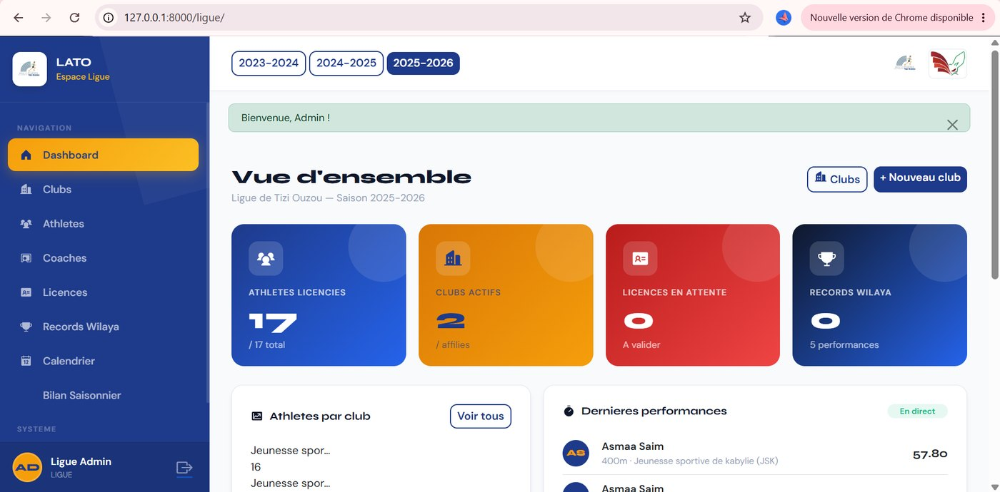
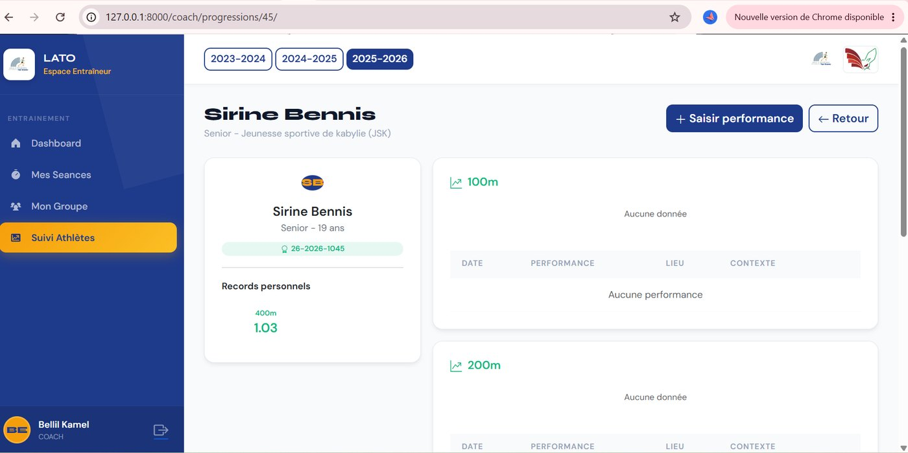
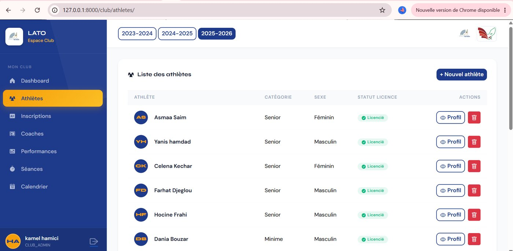
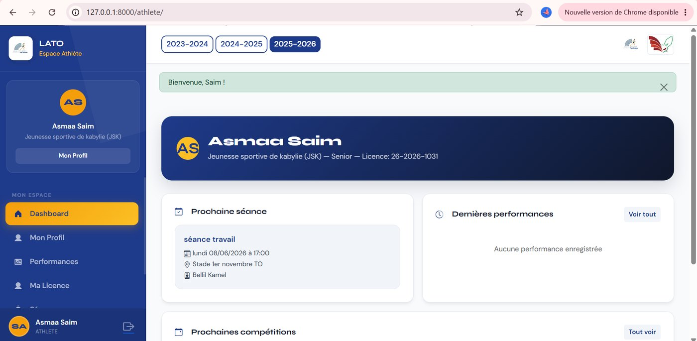

# LATO — Gestion de la Ligue d'Athlétisme de Tizi-Ouzou

Plateforme web pour gérer les clubs, les athlètes, les licences, les séances d'entraînement et le suivi des performances de la ligue, avec un espace dédié à chaque rôle (Ligue, Club, Coach, Athlète).

**Projet de fin d'études (PFE)** · Python · Django · SQLite · Bootstrap 5 · Chart.js

| Tableau de bord Ligue | Saisie des performances |
|---|---|
|  |  |

| Gestion des athlètes (club) | Espace athlète |
|---|---|
|  |  |

→ Toutes les captures et les diagrammes de conception : [docs/CONCEPTION.md](docs/CONCEPTION.md)

## Fonctionnalités

| Rôle | Ce qu'il peut faire |
|---|---|
| **Ligue (Super Admin)** | Gérer les clubs, valider les licences, consulter les statistiques globales, gérer les records de wilaya et le calendrier |
| **Admin de Club** | Gérer les coachs, les groupes et les inscriptions des athlètes, suivre les performances du club |
| **Coach** | Saisir les performances, planifier les séances, suivre la progression de ses athlètes |
| **Athlète** | Consulter son profil, sa licence, ses performances et ses records personnels |

- Détection automatique des records personnels et de wilaya, avec notification à la Ligue
- Statut de licence à quatre états (non licencié, incomplet, en attente, licencié)
- Filtrage par saison, graphiques dynamiques, interface responsive

## Installation

Prérequis : Python 3.12+

```bash
git clone <url-du-depot>
cd <nom-du-depot>

python -m venv .venv
source .venv/bin/activate        # Windows : .venv\Scripts\activate
pip install -r requirements.txt

cp .env.example .env             # puis renseigner SECRET_KEY
python manage.py migrate
python manage.py seed_db         # club de démo + compte Super Admin
python manage.py runserver
```

Ouvrir http://localhost:8000. Sous Linux/macOS, `./start.sh` fait tout cela d'un coup.

Le compte Super Admin utilise `ADMIN_EMAIL` / `ADMIN_PASSWORD` du `.env`. Si le mot de passe est vide, un mot de passe aléatoire est affiché une seule fois par `seed_db`. Les autres comptes se créent depuis l'application.

## Configuration (`.env`)

| Variable | Rôle |
|---|---|
| `SECRET_KEY` | Clé secrète Django (obligatoire) |
| `DEBUG` | `True` en développement uniquement (`False` par défaut) |
| `ALLOWED_HOSTS` | Hôtes autorisés, séparés par des virgules |
| `USE_HTTPS` | `True` en production derrière HTTPS (cookies sécurisés, HSTS) |
| `CORS_ALLOWED_ORIGINS` | Origines autorisées pour l'API (vide = aucune) |
| `ADMIN_EMAIL`, `ADMIN_PASSWORD` | Compte créé par `seed_db` |

## Tests

```bash
python manage.py test        # 83 tests : modèles, rôles, CSRF, cloisonnement, mots de passe, force brute
```

## Sécurité

- **Authentification** : mots de passe hachés avec bcrypt ; sessions limitées à 24 h, clé de session renouvelée à la connexion.
- **Mots de passe temporaires** : les comptes créés par l'application (admin de club, coach, athlète) reçoivent un mot de passe aléatoire de 12 caractères (module `secrets`) et **doivent le changer à la première connexion** ; tant que ce n'est pas fait, l'application et l'API sont inaccessibles. Les nouveaux mots de passe sont validés (10 caractères minimum, pas de mot de passe courant ni uniquement numérique).
- **Gestion des mots de passe depuis l'application** : chaque utilisateur peut changer son mot de passe (icône clé en bas du menu). La Ligue (tous les comptes sauf Ligue) et les admins de club (coachs et athlètes de leur club) disposent de la page **Comptes & mots de passe** pour réinitialiser un compte : un mot de passe temporaire est généré, les sessions ouvertes de la personne sont fermées et elle doit le remplacer à sa prochaine connexion. Pour les comptes Ligue ou en dernier recours : `python manage.py changepassword <utilisateur>` (administration Django) ou le shell Django.
- **Force brute** : 5 échecs consécutifs sur un même couple (IP, email) bloquent la connexion pendant 15 minutes (30 échecs par IP au total). Le compteur utilise le cache Django (`LocMemCache` par défaut) : en production avec plusieurs processus, configurer un cache partagé (Redis, Memcached).
- **CSRF** : toute action qui modifie ou supprime des données (suppression, suspension, validation et rejet de licence…) exige une requête `POST` avec jeton CSRF ; un simple lien ne peut plus la déclencher.
- **Cloisonnement** : un admin de club n'agit que sur les athlètes et coachs de son club, un coach que sur ses propres athlètes ; l'API est cloisonnée par rôle et par club.
- **Données** : aucune donnée réelle n'est versionnée (base, certificats médicaux et `.env` sont dans le `.gitignore`).

Limites connues : voir la section 2.8 de [docs/CONCEPTION.md](docs/CONCEPTION.md) (lien athlète ↔ compte par nom et prénom, épreuves saisies en texte libre).

## Documentation

Architecture, diagrammes UML, MCD/MLD, captures d'écran et API : [docs/CONCEPTION.md](docs/CONCEPTION.md)

## Licence

MIT — voir [LICENSE](LICENSE). Les logos et photos (ligue, fédération, clubs) appartiennent à leurs organisations respectives.
