# Documentation technique — LATO

[← Retour au README](../README.md)

## 1. Architecture

LATO suit le patron **MVT (Modèle-Vue-Template)** de Django, variante du MVC :

- **Modèle** : structure des données (athlètes, clubs, performances, licences…) et persistance SQLite via l'ORM Django ;
- **Vue** : logique métier, contrôle des droits selon le rôle, préparation des données ;
- **Template** : fichiers HTML qui affichent les données à l'utilisateur.

```
config/        Paramètres Django et routage principal
gestion/       Application : models, views, forms, api, tests, commandes
templates/     Interfaces HTML (public, ligue, club, coach, athlète)
static/        CSS, JavaScript, images, icônes
media/         Fichiers uploadés (non versionnés)
```

### Modèle de données

Entités principales : `Club`, `Utilisateur` (rôles : ligue, club_admin, coach, athlète), `Athlete`, `Performance`, `RecordWilaya`, `Seance`, `Evenement`, `Notification`, `Palmares`. Les diagrammes de conception sont présentés en section 2 ; le schéma logique réellement implémenté et ses écarts avec le MCD sont en sections 2.7 et 2.8.

## 2. Conception

La modélisation a été réalisée en UML puis en MCD/MLD.

### 2.1 Diagramme de contexte

Frontières du système et flux principaux entre la plateforme et ses quatre acteurs.

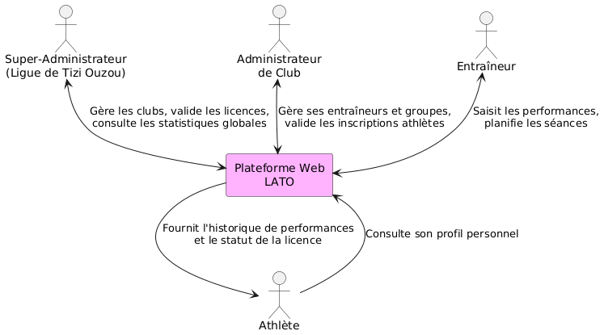

### 2.2 Diagrammes de cas d'utilisation

Vue générale : qui peut faire quoi. Toutes les actions incluent l'authentification.

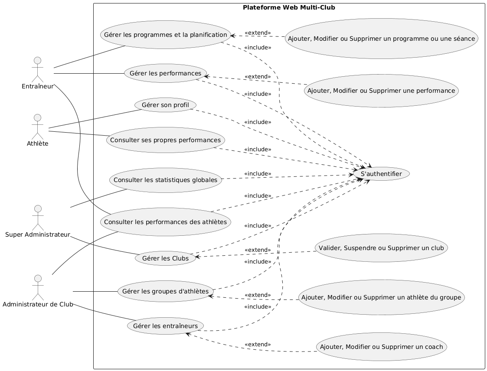

Module Entraîneur : gestion des performances, des programmes et de la planification.

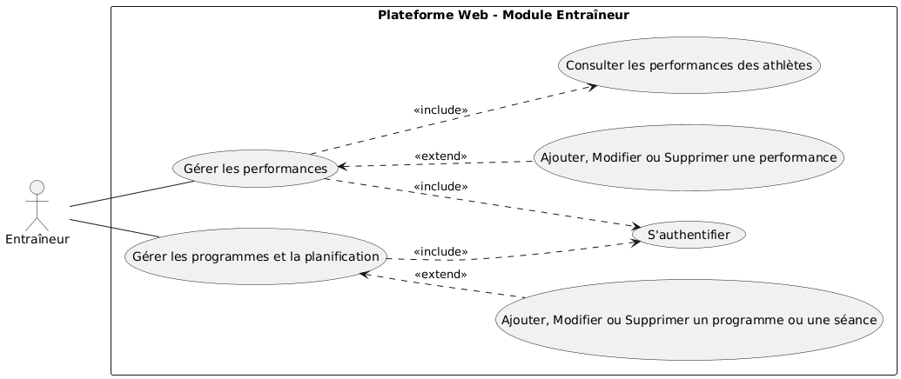

### 2.3 Diagrammes de séquence

**Authentification et redirection** : vérification des identifiants en base, récupération du rôle et redirection vers le portail correspondant.

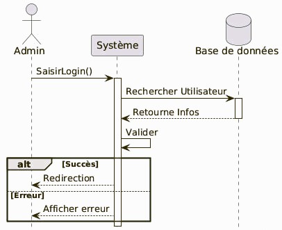

**Ajout d'une performance et détection de record** : après enregistrement, le système compare le résultat à l'historique de l'athlète, met à jour son record personnel et notifie la Ligue en cas de record de wilaya.

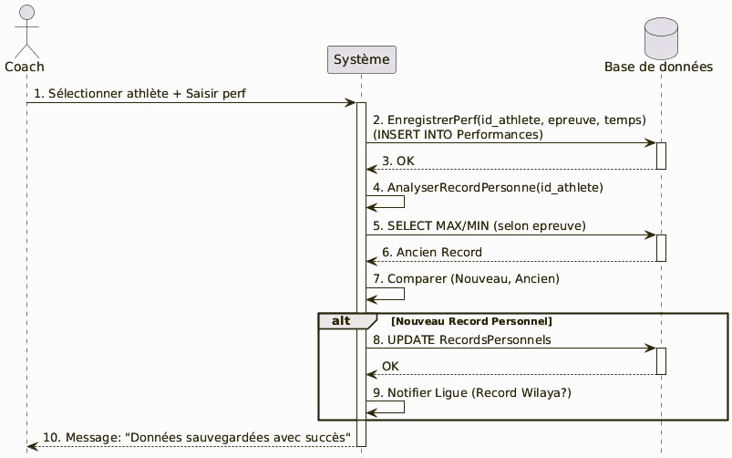

### 2.4 Diagramme de classes

Vue statique : entités métier, attributs et relations.

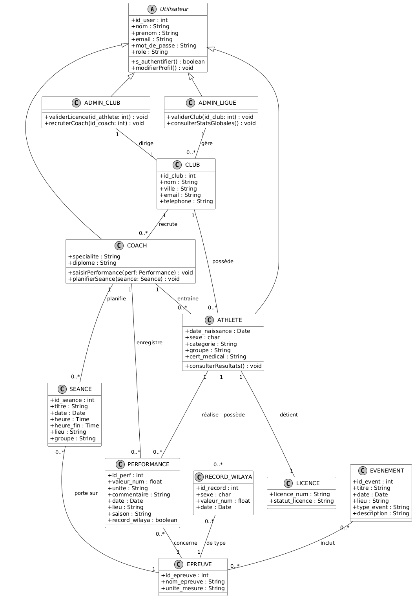

### 2.5 Diagrammes d'activité

**Authentification et gestion des accès**

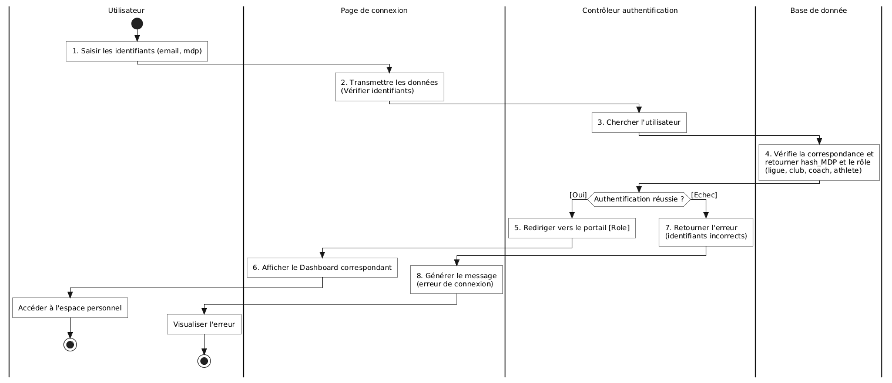

**Ajout et suivi des performances**

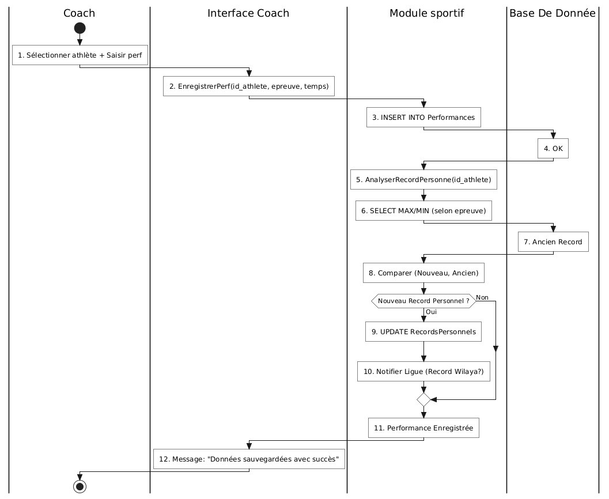

### 2.6 Modèle conceptuel des données (MCD)

Spécialisation de l'entité `UTILISATEUR` selon le rôle :

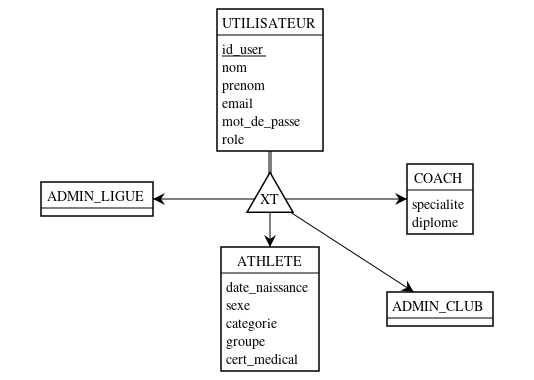

Schéma entité-association complet :

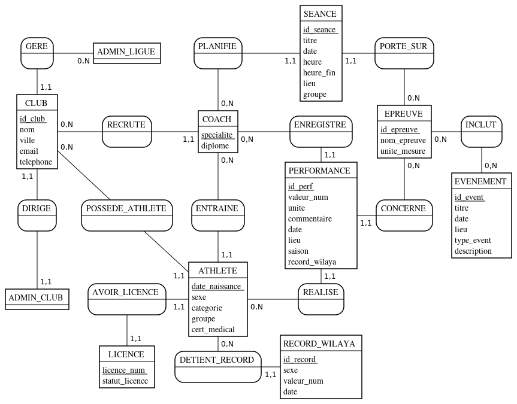

### 2.7 Modèle logique des données (MLD)

Schéma **réellement implémenté** (modèles Django, `gestion/models.py`, migrations 0001 à 0009).
Notation : clé primaire <u>soulignée</u> (`id`), clé étrangère précédée de `#`.

```
CLUB          (id, nom, ville, wilaya, email, telephone, informations_legales,
               statut, actif, created_at)

UTILISATEUR   (id, nom, prenom, email [unique], mot_de_passe [bcrypt], role,
               specialite, diplome, actif, must_change_password, created_at,
               #club_id)
               role ∈ {ligue, club_admin, coach, athlete}

ATHLETE       (id, nom, prenom, date_naissance, sexe, groupe, categorie,
               epreuves [JSON], statut_licence, licence_no, cert_medical,
               cert_medical_img, dossier_medical_url, poids, taille, saison,
               created_at, #club_id, #coach_id → UTILISATEUR)
               statut_licence ∈ {non_licencie, incomplet, en_attente, licencie}

PERFORMANCE   (id, epreuve, performance, valeur_num, unite, commentaire, date,
               lieu, record_wilaya, saison, created_at,
               #athlete_id, #coach_id → UTILISATEUR)

RECORD_WILAYA (id, epreuve, sexe, performance, valeur_num, athlete_nom,
               club_nom, date, updated_at, #athlete_id)
               unique (epreuve, sexe)

SEANCE        (id, titre, date, heure, heure_fin, lieu, epreuve, groupe,
               contenu_pedagogique, notes, saison, created_at,
               #club_id, #coach_id → UTILISATEUR)

EVENEMENT     (id, titre, date, lieu, type_event, saison, epreuves, description,
               programme [fichier], created_at)

NOTIFICATION  (id, destinataire_role, texte, lu, created_at,
               #club_id, #athlete_id)

PALMARES      (id, saison, competition, nature, epreuve, date, lieu,
               classement, performance, created_at, #athlete_id)
```

Comportement des clés étrangères à la suppression :

| Relation | Suppression du parent |
|---|---|
| `PERFORMANCE → ATHLETE`, `PALMARES → ATHLETE`, `NOTIFICATION → ATHLETE / CLUB` | **CASCADE** : les enfants sont supprimés |
| `ATHLETE → CLUB`, `UTILISATEUR → CLUB`, `SEANCE → CLUB` | SET NULL : l'enfant est conservé, sans club |
| `ATHLETE → UTILISATEUR (coach)`, `PERFORMANCE → UTILISATEUR`, `SEANCE → UTILISATEUR` | SET NULL |
| `RECORD_WILAYA → ATHLETE` | SET NULL (le nom de l'athlète et du club est dénormalisé pour conserver l'historique du record) |

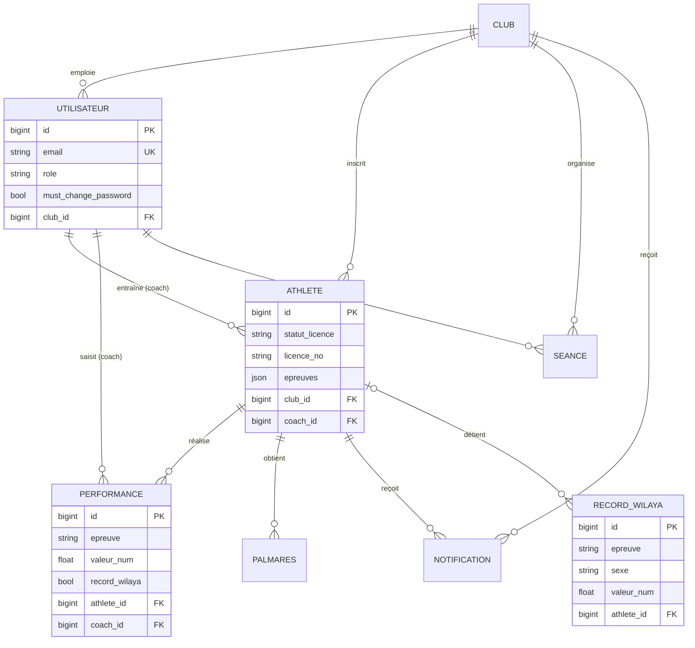

### 2.8 Écarts entre la conception (MCD) et l'implémentation

Les diagrammes 06, 09 et 10 ci-dessus représentent le modèle **conceptuel** issu de l'analyse. L'implémentation Django s'en écarte sur les points suivants, par simplification :

| Conception (MCD) | Implémentation |
|---|---|
| Spécialisation `ADMIN_LIGUE`, `ADMIN_CLUB`, `COACH`, `ATHLETE` d'`UTILISATEUR` (héritage) | Une seule table `utilisateurs` avec un champ `role` ; `specialite` et `diplome` ne servent qu'aux coachs |
| Entité `LICENCE` (`licence_num`, `statut_licence`) | Fusionnée dans `ATHLETE` (`licence_no`, `statut_licence`) : une licence correspond à un athlète et à une saison |
| Entité `EPREUVE` (`nom_epreuve`, `unite_mesure`) et association `INCLUT` (événement ↔ épreuve) | Pas de table : l'épreuve est une chaîne de caractères (liste fermée dans `forms.py`). Le sens « le plus grand est meilleur » ou « le plus petit est meilleur » est déduit du nom de l'épreuve (`est_epreuve_distance()` dans `models.py`) |
| `ATHLETE` hérite d'`UTILISATEUR` (`#id_user`) | `ATHLETE` est une table indépendante. Le compte de connexion d'un athlète (`role = athlete`) est retrouvé par correspondance prénom + nom + club |
| `ATHLETE.sexe` / catégorie / groupe | Identiques ; `categorie` est une liste fermée (Benjamin à Master) |
| `NOTIFICATION`, `PALMARES`, `must_change_password`, `saison` | Ajouts de l'implémentation, absents du MCD |

**Limites connues de ce choix.** L'absence de table `EPREUVE` rend possibles des fautes de saisie dans le nom d'une épreuve ; l'absence de lien direct entre `ATHLETE` et `UTILISATEUR` rend ambigu le cas de deux homonymes dans un même club. Une évolution naturelle serait d'ajouter une clé étrangère `utilisateur_id` sur `ATHLETE` et une table `EPREUVE` avec un champ `sens_meilleur_resultat`.

## 3. Aperçu de l'application

### Site public et authentification

| Page d'accueil | Connexion |
|---|---|
|  |  |

### Espace Ligue

Tableau de bord : indicateurs clés (athlètes licenciés, clubs actifs, licences en attente, records de wilaya), graphiques et dernières performances.

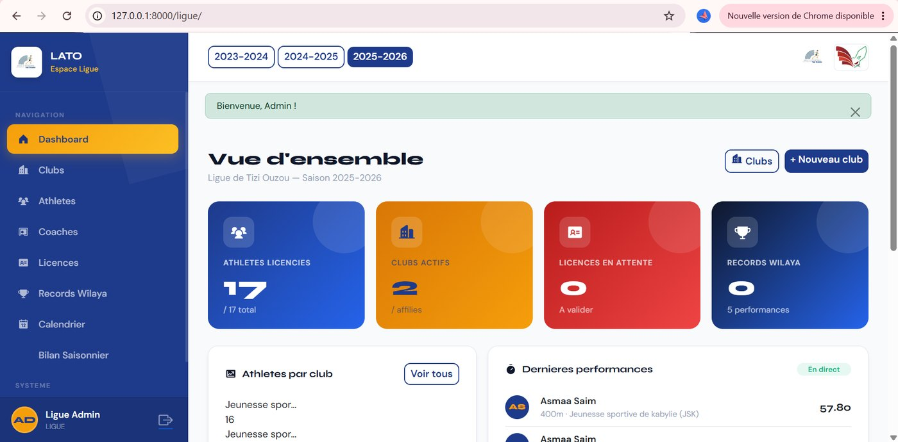

Gestion des clubs affiliés : création, activation/suspension, fiche détaillée.

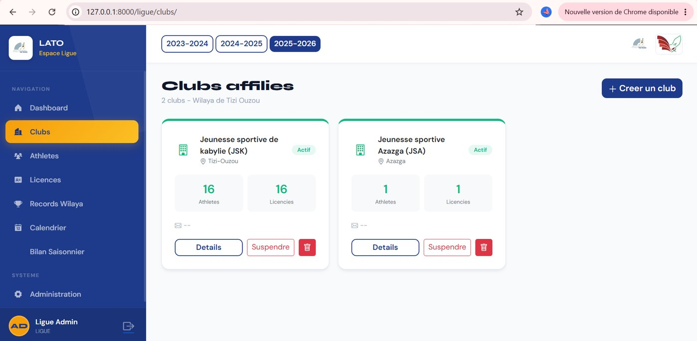

### Espace Club

| Tableau de bord du club | Gestion des athlètes (statut de licence) |
|---|---|
| 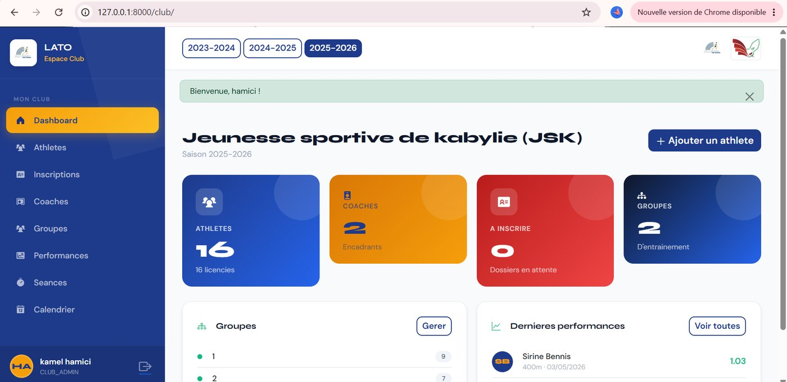 | 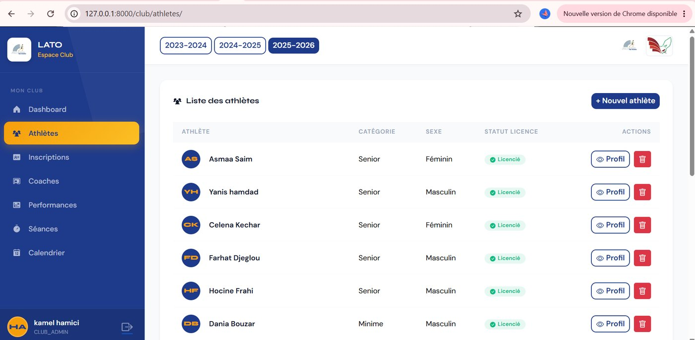 |

### Espace Coach

| Tableau de bord du coach | Suivi et saisie des performances |
|---|---|
| 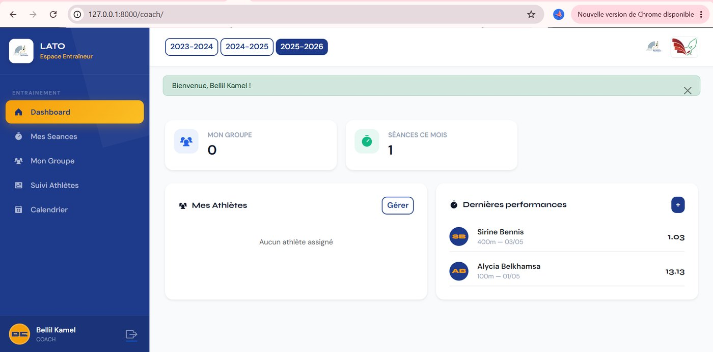 | 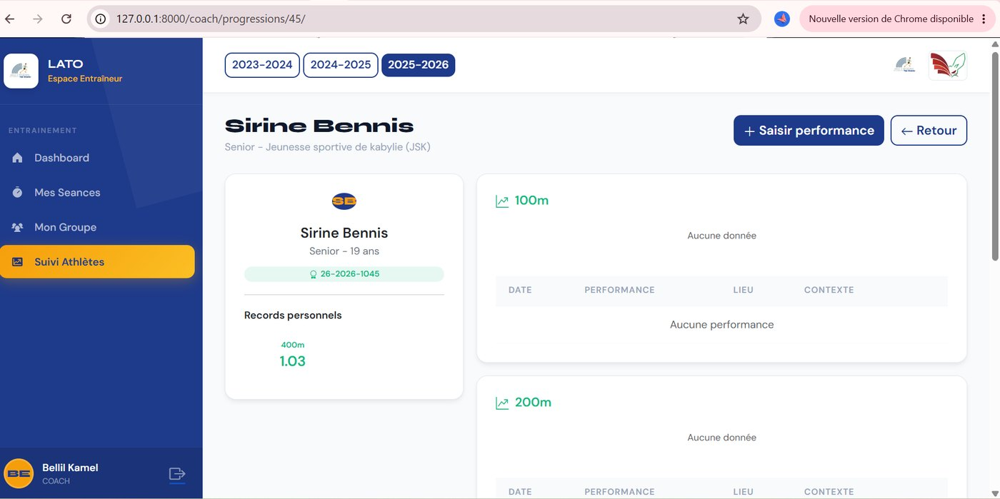 |

### Espace Athlète

| Tableau de bord de l'athlète | Fiche personnelle |
|---|---|
| 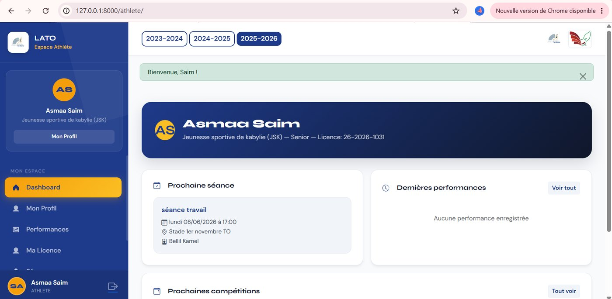 | 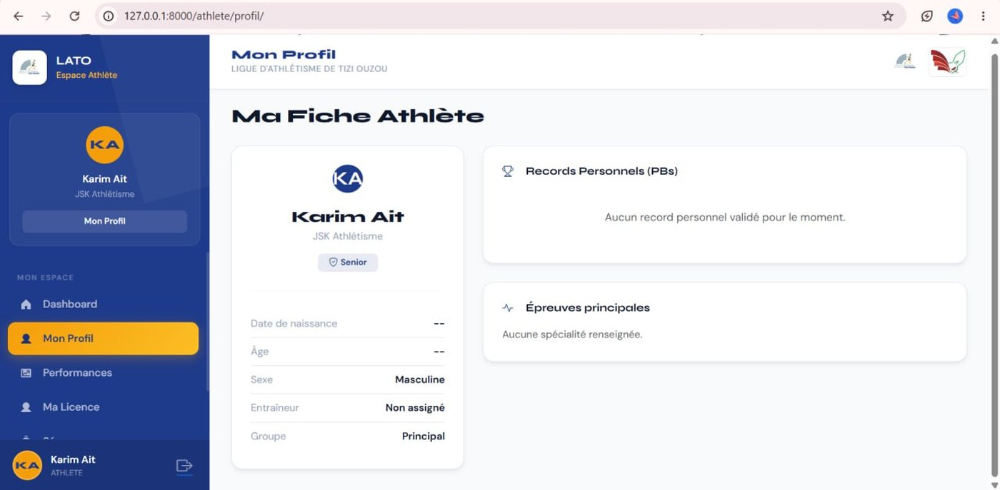 |

## 4. API JSON (session requise)

Accès par rôle : la lecture est ouverte à la Ligue, aux admins de club et aux coachs (limités à leur club) ; l'écriture est réservée au rôle concerné (création de clubs et d'événements : Ligue ; saisie des performances et des séances : coach ; validation des licences : Ligue).

```
GET      /api/stats
GET/POST /api/clubs              GET/PUT  /api/clubs/<id>
GET/POST /api/athletes           GET/PUT  /api/athletes/<id>
POST     /api/athletes/<id>/valider | prevalider | rejeter
GET/POST /api/performances       GET/POST /api/seances
GET/POST /api/evenements         GET      /api/records
GET      /api/notifications/<role>
GET/POST /api/utilisateurs
```
